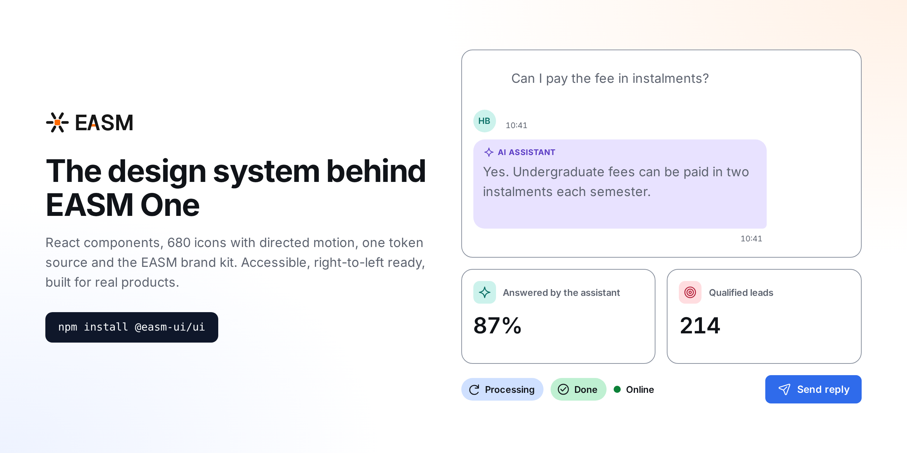
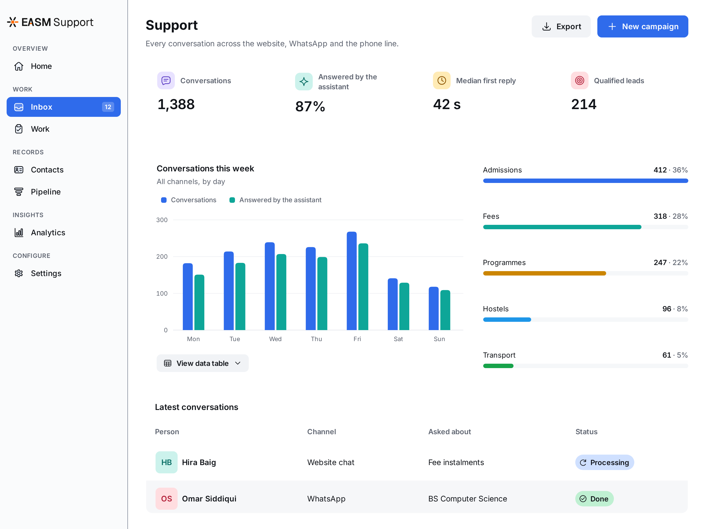
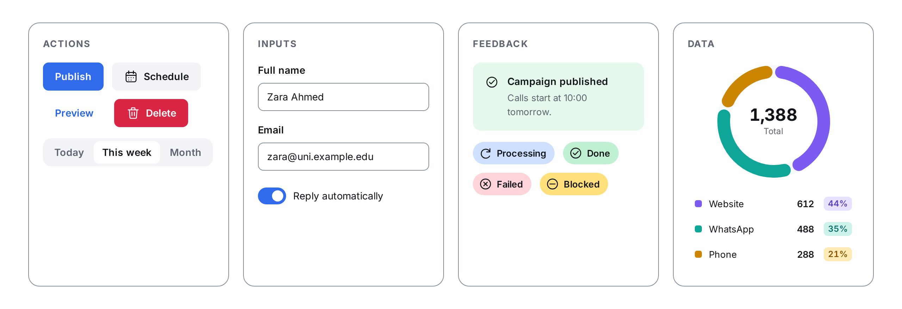
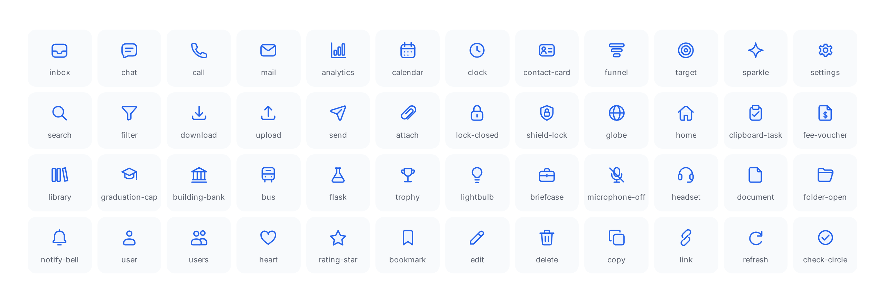
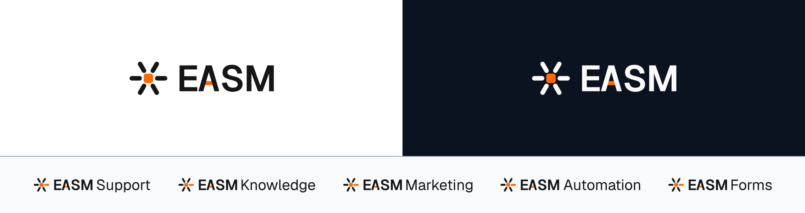

<p align="center">
  
</p>

<p align="center">
  <a href="https://www.npmjs.com/package/@easm-ui/ui"></a>
  <a href="https://www.npmjs.com/package/@easm-ui/icons"></a>
  <a href="https://www.npmjs.com/package/@easm-ui/brand"></a>
  <a href="https://github.com/easm-ui/design-system/actions/workflows/ci.yml"></a>
  
  <a href="LICENSE"></a>
</p>

<p align="center">
  <b>React components, icons with directed motion, one token source and the EASM brand kit.</b><br>
  The system every EASM One dashboard is built from: Support, Knowledge, Marketing, Automation and Forms.
</p>

<p align="center">
  <a href="#install">Install</a> ·
  <a href="#whats-inside">What's inside</a> ·
  <a href="packages/ui/docs/COMPONENT-SPECS.md">Component specs</a> ·
  <a href="packages/ui/docs/FOUNDATIONS.md">Foundations</a> ·
  <a href="https://easm.co">easm.co</a>
</p>

---



## Why EASM UI

|  |  |
| --- | --- |
| **Built for real products** | Every component ships in production across five EASM One dashboards, used by universities every day: inboxes, pipelines, call campaigns, forms and analytics. |
| **Accessible by default** | Every component, state and demo is checked with axe against WCAG 2.2 A/AA on every pull request. Keyboard paths, focus rings and screen-reader names are part of each component's spec. |
| **Right-to-left ready** | Set `dir` and `lang` and everything follows, including menus, dialogs and drawers that open from a region in another language. |
| **One source of truth** | Colours, type, spacing, radius and motion live in one DTCG token file. CSS variables, TypeScript values and a Tailwind v4 theme are generated from it, and CI fails if they drift. |
| **Motion with meaning** | 309 directed icon motions show what an action does (a download arrives, a message is delivered, a file is discarded) and rest on the exact artwork. `prefers-reduced-motion` turns it all off. |
| **Specified, not just coded** | Each core component has a fifteen-part specification: purpose, anatomy, variants, states, colour, motion, accessibility, responsive behaviour and content rules. |

## Install

```bash
npm install @easm-ui/ui @easm-ui/icons
```

`@easm-ui/ui` brings `@easm-ui/brand` with it. The packages are compiled ES modules with TypeScript types for any React 19 app: Next.js (App Router), Vite, Remix or plain Node.

Load the styles once and mark the page:

```tsx
// Next.js: app/layout.tsx · Vite: src/main.tsx
import '@easm-ui/ui/styles.css';

<body className="easm-ui easm-ui-page">…</body>
```

Then build:

```tsx
import { Button, Card, StatCard, DataTable } from '@easm-ui/ui';

export function Overview() {
  return (
    <Card title="Admissions this week" icon="analytics">
      <StatCard label="Qualified leads" value={214} icon="target" tone="coral" />
      <Button leadingIcon="download">Export</Button>
    </Card>
  );
}
```

Icons are named, not imported: `leadingIcon="save"`, `icon="inbox"`. Load [Inter](https://fonts.google.com/specimen/Inter) for type; without it text falls back to the system font.

## What's inside



### [`@easm-ui/ui`](packages/ui): components

Core controls, navigation, data display and charts, forms, overlays, feedback and the product patterns EASM One is made of: conversation threads, pipelines, call controls, schedules, notification centres, settings layouts and more. Server-rendering safe, client components where they need to be, and router-aware links through `EasmUIProvider`.



### [`@easm-ui/icons`](packages/icons): 682 icons

One 24 px grid, one stroke, drawn for education and operations: fee vouchers, timetables, transcripts, admissions, campus, calls and AI work alongside the everyday set. `Icon` and `IconButton` for static use, `MotionIcon` with 309 directed recipes, and `BrandIcon` for the services a product connects to (WhatsApp, Google, Microsoft, Moodle, Stripe and others).



### [`@easm-ui/brand`](packages/brand): the EASM brand kit

The EASM logo and product lockups, the animated app icon in twelve working states (idle, listening, thinking, searching, writing, speaking and more), the voice waveform, typing dots, particle and dot backgrounds, and the EASM mascot. Re-exported by `@easm-ui/ui`. The brand artwork is EASM's and is not covered by the MIT licence; see [TRADEMARKS.md](TRADEMARKS.md).

### [`tokens/`](tokens): the source of every value

`easm.tokens.json` in the [DTCG](https://www.designtokens.org/) format, built with Style Dictionary into CSS variables (`--easm-ui-*`), a typed `tokens` export and a Tailwind v4 theme, with every colour pair checked for WCAG contrast.

## Use it with your stack

<details>
<summary><b>Next.js</b></summary>

- No `transpilePackages` needed; the packages are compiled.
- The components are client components, so they render inside server components too. Props that are functions (a DataTable column's `value`, `onValueChange`, `onClick`) cannot cross from a server component: put that part of the page in a `'use client'` file.
- Mount `EasmUIProvider` once with your router's link so every link EASM UI renders navigates client-side:

```tsx
// app/providers.tsx
'use client';
import Link from 'next/link';
import { EasmUIProvider } from '@easm-ui/ui';

export function Providers({ children }: { children: React.ReactNode }) {
  return <EasmUIProvider linkComponent={Link}>{children}</EasmUIProvider>;
}
```

Your own links can use `EasmLink` (`<EasmLink href="/inbox">Inbox</EasmLink>`).
</details>

<details>
<summary><b>Tailwind CSS v4</b></summary>

Tailwind and EASM UI work side by side. Component rules are unlayered, so Tailwind's reset never overrides a component; base rules sit in `@layer base`, so a utility on your own element always wins.

```css
@import "tailwindcss";
@import "@easm-ui/ui/tailwind.css";
```

Then `bg-easm-surface`, `text-easm-text-secondary`, `rounded-easm-card`, `font-easm` and the rest follow the tokens. Without Tailwind, use the CSS variables (`var(--easm-ui-surface)`) or import `@easm-ui/ui/tokens.css` alone.
</details>

<details>
<summary><b>Right-to-left and mixed-language pages</b></summary>

Set `dir` and `lang` on `<html>` and on any region in another language (an English screen inside an Urdu app). Menus, selects, popovers, tooltips, dialogs and drawers render at the end of `<body>`, so each takes the direction and language of the place it opens from; a drawer's `side="start"` follows that direction.
</details>

<details>
<summary><b>Motion</b></summary>

The stylesheet adds quiet motion where components are used: the selected tab slides, table rows cascade in, a new statistic rises in, skeletons shimmer, buttons press. `easm-ui-page-head`, `easm-ui-enter`, `easm-ui-stagger` and the `--easm-ui-motion-*` tokens give your own pages the same timing. `prefers-reduced-motion` and `data-easm-motion="off"` on any ancestor turn it all off.

`MotionIcon` plays directed icon motion on demand; `trigger="interaction"` adds a small client boundary for pointer and keyboard hints.
</details>

## Contributing

```bash
pnpm install
pnpm check
```

`pnpm check` verifies the generated tokens, builds, type-checks, and runs the component tests, the axe accessibility checks and the icon motion test, exactly as CI does. Commits follow Conventional Commits and releases come from Changesets. Read [CONTRIBUTING.md](CONTRIBUTING.md) for the workflow and the deprecation policy, and [SECURITY.md](SECURITY.md) to report a vulnerability.

The pictures in this README are drawn by the packages themselves: `node .github/readme/build.mjs` renders them from [`scenes.tsx`](.github/readme/scenes.tsx).

## Licence

Code, tokens, documentation and the icon set are [MIT](LICENSE). The EASM name, logo, wordmark and mascot are trademarks of EASM, all rights reserved: see [TRADEMARKS.md](TRADEMARKS.md). Marks drawn by `BrandIcon` belong to their owners.

<p align="center"><sub>Made by <a href="https://easm.co">EASM</a> for universities.</sub></p>
